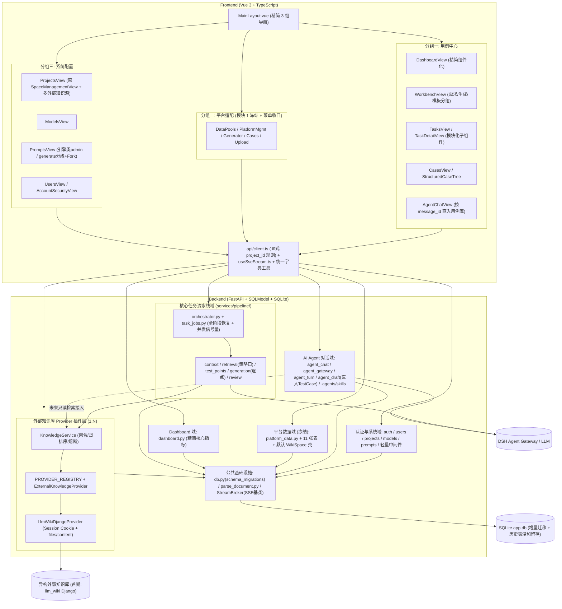

# CaseGen 架构重构方案与分阶段实施计划

- **制定日期**：2026-11-20
- **权威依据**：[2026-11-20-casegen-refactor-decisions.md](../specs/2026-11-20-casegen-refactor-decisions.md)
- **目标读者**：主协调代理（coordinator）、前后端实现代理（implementer）、只读审查代理（reviewer）与项目维护者
- **执行原则**：按 Phase 渐进演进、每阶段先补迁移/回归测试再删旧代码、严守冻结红线与数据兼容性

---

## 一、重构总目标与硬约束红线

### 1.1 重构总目标（减重提稳、收口边界、预留演进）

1. **大幅减重**：彻底砍掉内嵌 Wiki 2.0 知识库（约 40%+ 冗余体量，含文档摄入、切块、编译、风险审阅、回滚、共享库与本地 FTS5 检索及 4 个前端页面），消除无用概念与死代码。
2. **核心提稳**：拆解 `task_pipeline.py`（2,664 行）与 `TaskDetailView.vue`（2,457 行）超级大文件，修复已确认 Bug（`### 待确认项` 解析、重启恢复盲区、Agent 历史气泡转存错位、`api/client.ts` 盲注 `project_id`、Dashboard 8 小时时区偏移等），补齐后台并发限流与统一 SSE 流式契约。
3. **干净扩展面**：
   - 落地 **1:N 多异构外部知识库 Provider 插件架构**（`ExternalKnowledgeProvider` Protocol + `PROVIDER_REGISTRY`），做到「新增一种外部知识库 = 新增一个 Adapter」；
   - 在拆解后的 `services/pipeline/retrieval.py` 预留清晰策略接口，并与统一外部知识检索工具及 `agent_gateway.py` 对齐，为后续「流水线关键阶段融入 Agent 多轮自主检索」打好架构基础；
   - 落地提示词分级治理（系统引擎类归 `admin`，`generate` 支持 `system`/`shared`/`private` 与 Fork 复制）。

### 1.2 四条不可逾越的硬约束红线

1. **红线 1（模块 1 零破坏冻结契约）**：
   - 严禁修改 `backend/app/api/platform_data.py`、`backend/app/schemas/platform_data.py`、11 张平台/数据池相关表及 `DataPoolsView.vue`、`PlatformManagementView.vue`、`PlatformCaseGeneratorView.vue`、`PlatformCasesView.vue`、`PlatformUploadView.vue`、`ExampleContentPreview.vue`、`api/platformData.ts` 业务逻辑；
   - 必须保留底层静默默认 `WikiSpace` 壳（`projects.default_wiki_space_id` 与只读 `GET /api/wiki-spaces`）、`TestCase` 表及语义用例读取能力、`ModelConfig`、内置 Prompt 类型 `data_description_parse` 与 `platform_example_render`。
2. **红线 2（老数据零丢失）**：
   - 对 `data/meta/app.db` 执行结构或数据迁移前必须自动备份 `.bak`；
   - 兼容现有用户、项目、模型、提示词、任务、用例、平台数据、Agent 会话全部存量数据；旧 Wiki 历史表温和留存、**严禁暴力 `DROP TABLE`**，代码层停止读写即可。
3. **红线 3（隐私红线）**：
   - 普通用户的 `private` 生成提示词模板与个人 Agent 对话会话，**`admin` 管理员亦不可查看或检索**。
4. **红线 4（`tools/` 保持不动）**：
   - 不修改 `tools/runtime_validation/`、`tools/scenario_benchmark/` 等目录下的任何评测或验证脚本。

---

## 二、重构后目标架构与模块清单

### 2.1 目标架构图

### 2.2 精简后侧边栏导航（3 组）与后端域对照

| 前端分组 | 包含页面 / 入口 | 对应后端域 | 变更说明 |
| :--- | :--- | :--- | :--- |
| **用例中心** | 工作台、任务列表/详情、用例管理、AI 对话、数据看板 | `tasks`、`requirements`、`cases`、`agent_chat`、`dashboard` | 清理 4 个内嵌 Wiki 页面及空间选择器 |
| **平台适配** | 数据池、平台管理、平台用例生成、平台用例、平台产物 | `platform_data`（冻结）+ 只读 `wiki_spaces` 壳 | 原「数据池」移入此组；内部业务零改动 |
| **系统配置** | 项目管理、模型配置、提示词管理、用户管理、账号安全 | `projects`、`knowledge_sources`、`models_cfg`、`prompts`、`users`、`auth` | 原「空间管理」更名「项目管理」并承载多知识源 |

---

## 三、分阶段实施计划（Phase 0 ~ Phase 5）

### Phase 0：基线整理、临时文件清理、版本化迁移底座与 Mock 升级

- **目标**：建立干净的仓库卫生基线、可追踪的数据库版本化迁移底座，以及对齐真实外部知识库契约的本地 Mock 服务，为后续并行开发提供稳定沙箱。
- **涉及文件 / 模块边界**：
  - 仓库临时文件：`casegen.zip`、`压缩文件.zip`、`backend/nohup.out`、`frontend/nohup.out`、`test.py`、`开箱即用-前端.txt`（核实确认无引用后清理）；
  - 前端死代码：`frontend/src/components/HelloWorld.vue`；
  - 数据库底座：`backend/app/db.py`、`backend/app/models/entities.py`；
  - Mock 服务：`backend/mock_external_wiki/server.py`（对齐 `docs/llm-wiki-reference/API_README.md`）。
- **核心改动项**：
  1. **分支与基线归档**：确认当前 `feat/dsh-agent-integration` 工作区未提交 WIP 的处理策略（归档/基线提交后再开重构分支或分阶段提交），确保随时可回滚。
  2. **清理临时残留与死代码**：删除根目录及前后端残留临时压缩包、日志、临时脚本与零引用的 `HelloWorld.vue`；严禁触碰 `data/` 与 `tools/`。
  3. **引入 `schema_migrations` 版本表**：在 `backend/app/db.py` 新建 `schema_migrations(version, name, applied_at)` 迁移登记机制，对新库与存量老库统一打底基线版本号，执行迁移前若存在 `data/meta/app.db` 则自动创建时间戳 `.bak` 备份；逐步替代启动时无版本全量探表。
  4. **升级 `backend/mock_external_wiki/server.py`**：补齐 Django Session 登录鉴权与全量核心端点：`POST /api/auth/login/`、`GET /api/auth/me/`、`GET /api/projects/`、`POST /api/projects/{id}/search/`、`GET /api/projects/{id}/files/`、`GET /api/projects/{id}/file-content/`。
- **验收标准**：
  - 仓库不再存在指定临时残留文件与 `HelloWorld.vue`，`git status` 清晰；
  - `db.py` 针对空库与真实 `app.db` 副本均可幂等启动并写入 `schema_migrations`，且自动生成 `.bak`；
  - `mock_external_wiki` 具备完整认证、搜索、文件列表与正文读取单元/冒烟验证通过；
  - 现有 `pytest -q` 与 `npm run build` 基线可运行通过。

---

### Phase 1：多异构外部知识库 Provider 架构上线 + 内嵌 Wiki 2.0 彻底下线

- **目标**：建成支持 1:N 多异构外部知识源的插件化 Provider 底座并打通前端动态配置与全文预览；彻底剥离内嵌 Wiki 2.0 全套模块，同时严守默认 `WikiSpace` 壳与 `parse_document.py` 的零破坏保护。
- **涉及文件 / 模块边界**：
  - **后端新增**：`backend/app/services/knowledge_providers/`（`base.py`、`registry.py`、`llm_wiki_django.py`、`service.py`）、`backend/app/api/knowledge_sources.py`、`backend/app/schemas/knowledge_sources.py`、`ProjectKnowledgeSource` 数据模型；
  - **后端保留与改造**：`backend/app/services/parse_document.py`（保留）、`backend/app/models/entities.py` / `wiki_spaces.py`（保留只读 `WikiSpace` 壳与 `default_wiki_space_id`）、`backend/app/services/pipeline/` 或现有检索阶段对接新 `KnowledgeService`；
  - **后端下线**：`api/documents.py`、`api/wiki.py`、16 个 `wiki_*.py`、`source_chunking.py`、`source_chunks_store.py`、`clause_index.py`、`document_delete.py`、`retrieve.py`、`default_wiki/`、`default_prompts/wiki_analyze.md`、`default_prompts/wiki_write.md`、本地知识冲突裁决接口与相关 FTS5 逻辑（数据库旧 Wiki 表不 DROP，只停止代码读写）；
  - **前端改动**：移除 `DocumentsView.vue`、`WikiView.vue`、`WikiReviewView.vue`、`WikiSpacesView.vue`、`api/documents.ts`、`api/wiki.ts` 及侧边栏 Wiki 分组与任务页空间选择器；将 `SpaceManagementView.vue` 改造为项目管理页（含多外部知识源动态列表/表单）；升级 `CitationList.vue`（经后端代理读取外部文件正文）；改造任务检索确认阶段对「未配置知识库」与「检索 0 命中」的明确提示与用户确认继续流程。
- **核心改动项**：
  1. **数据模型与老数据平滑迁移**：新增 `ProjectKnowledgeSource` 表（支持 1:N 多源、`provider_type`、`auth_type`、`config_json`、`credentials_json` 脱敏、`weight`/`priority`/`enabled`），通过 `schema_migrations` 自动将老 `ProjectExternalWiki` 记录迁移为 `provider_type="llm_wiki_django"` 条目；出参严禁回显密码明文，编辑留空保持原密码。
  2. **Provider 插件抽象与 `LlmWikiDjangoProvider`**：
     - 定义 `ExternalKnowledgeProvider` Protocol 与 `PROVIDER_REGISTRY`，统一 `test_connection`、`list_remote_scopes`、`search -> list[KnowledgeHit]`、`list_files`、`read_file_content` 与能力声明（capability flags）；
     - 实现 `LlmWikiDjangoProvider`：基于 `httpx.Client` CookieJar 自动调用 `/api/auth/login/` 建立 Django Session，401/403 自动重登续期，配置超时、有限重试与熔断降级，支持 `/files/` 与 `/file-content/`。
  3. **统一聚合检索与兜底策略**：`KnowledgeService` 按项目聚合启用知识源并归一排序；未配置外部知识库或检索 0 命中时，分别返回结构化提示状态，前端明确提示且允许用户确认（可选补充背景）后继续生成测试点。
  4. **安全下线内嵌 Wiki 2.0**：先补齐外部知识库契约单测与迁移单测，再摘除 `main.py` 路由注册、旧服务与旧前端视图，保留 `parse_document.py` 与 `GET /api/wiki-spaces` 只读壳。
- **验收标准**：
  - 使用升级后的 `mock_external_wiki` 完成「配置多知识源 → 登录鉴权 → 检索 → 引用抽屉读取全文」端到端单测/集成测试；
  - 模拟“未配置外部库”和“检索 0 命中”时流水线提示准确且用户确认后可继续完成后续步骤；
  - 需求导入（`/api/requirements/import-doc`）与平台模块（`/api/wiki-spaces`、`/api/data-pools`、`/api/platforms`）全部正常；
  - `npm run build` 与后端 `pytest -q` 全绿。

---

### Phase 2：系统底座收口与提示词分级权限治理

- **目标**：收口前端路由/导航/请求客户端与后端鉴权中间件的通用底座缺陷，并上线可落地的提示词分级权限与模板 Fork 机制。
- **涉及文件 / 模块边界**：
  - **后端**：`backend/app/models/entities.py`（`PromptTemplate` 增量字段）、`backend/app/db.py`（迁移版本）、`backend/app/api/prompts.py`、`backend/app/services/prompts_seed.py`、`backend/app/api/tasks.py`、`backend/app/main.py`（鉴权中间件）与 `backend/app/services/auth.py`；
  - **前端**：`frontend/src/layouts/MainLayout.vue`、`frontend/src/router/index.ts`、`frontend/src/api/client.ts`、`frontend/src/views/PromptsView.vue`、`frontend/src/views/WorkbenchView.vue`、`frontend/src/api/prompts.ts`。
- **核心改动项**：
  1. **导航收口与概念更名**：侧边栏精简为 3 组（用例中心 / 平台适配 / 系统配置），「数据池」入口移入「平台适配」分组；「空间管理」更名为「项目管理」。
  2. **提示词分级权限与 Fork**：
     - 清理 `wiki_analyze`、`wiki_write`；
     - 系统引擎类（`review`、`test_points`、`requirement_optimize`、`optimize`、`data_description_parse`、`platform_example_render`）仅 `admin` 可见与维护；
     - `PromptTemplate` 新增 `owner_user_id`（`NULL` 为系统预置）与 `visibility`（`system` / `shared` / `private`），存量全部迁移为 `system`；
     - 严格权限隔离：`private` 模板仅作者本人可见可用可改删（**严禁 `admin` 窥探**）；`shared` 全员可见可用、仅作者及 `admin` 可治理；`system` 全员可见可用、仅 `admin` 可改删；
     - 新增 Fork 复制接口（基于 `system`/`shared` 一键复制为个人 `private` 模板）；工作台下拉按「系统预置 / 我的模板 / 团队共享」分组；创建任务时后端严格校验模板归属权限，禁止删除被进行中任务引用的模板；**下线 `apply_prompt(mode="global")`**。
  3. **前后端底座缺陷修复**：
     - `api/client.ts`：不再对 `/api/projects`、`/api/users`、`/api/models`、`/api/prompts` 等全局端点盲注 `project_id`，统一收口 `api()` 与 `apiBlob()` 重复逻辑；
     - `MainLayout.vue`：`skipProjectGate` 全局页不随顶部项目切换而销毁重建；取消每次切路由盲目拉取 `listModels()`；`/agent` 页面隐藏流水线默认模型徽章；
     - `main.py` 鉴权中间件：合并单请求重复开启 SQLite Session 与散落正则校验。
- **验收标准**：
  - 权限单测全覆盖：`admin` 无法查询/读取/修改普通用户的 `private` 模板；普通用户不可见引擎类模板且无法越权使用他人 `private` 模板；Fork、任务引用删除保护、全局改写下线均验证通过；
  - 前端切换项目时全局页状态不丢失、网络面板无多余 `listModels` 重复调用、全局接口不携带无效 `project_id`；
  - `pytest -q` 与 `npm run build` 通过。

---

### Phase 3：核心任务流水线拆解与健壮性加固

- **目标**：彻底拆分巨型文件，消灭长任务重启丢失与并发失控隐患，统一流水线与测试路径，抽离前后端共享组件与流式基类。
- **涉及文件 / 模块边界**：
  - **后端**：`backend/app/services/task_pipeline.py` 拆分为 `backend/app/services/pipeline/`（`__init__.py`、`context.py`、`retrieval.py`、`test_points.py`、`generation.py`、`review.py`、`orchestrator.py`）；`backend/app/services/task_jobs.py`、`backend/app/services/case_management.py`、`backend/app/api/tasks.py`、`backend/app/services/stream_broker.py`（新建公共基类）、`task_stream.py`、`agent_stream.py`；
  - **前端**：`frontend/src/views/TaskDetailView.vue` 拆分为 `frontend/src/components/task/` 子组件；新建共享 `frontend/src/components/common/StructuredCaseTree.vue` 与状态/优先级统一字典 `frontend/src/utils/caseDictionaries.ts`、剪贴板工具 `frontend/src/utils/clipboard.ts`；升级 `frontend/src/composables/useSseStream.ts`。
- **核心改动项**：
  1. **拆解 `task_pipeline.py`**：按阶段拆分职责清晰模块；在 `retrieval.py` 抽象 `RetrievalStrategy` 接口（默认调用 Phase 1 的 `KnowledgeService`，为后续无缝替换为 Agent 多轮检索留出标准接入位）。
  2. **统一逐点生成与单点降级重试**：删除 `PYTEST_CURRENT_TEST` 分叉及旧整篇生成路径（同步清理仅测旧整篇路径的测试），生产与测试统一走逐点生成；将精简上下文降级策略收口为单点异常降级重试。
  3. **并发控制、重启恢复与查询优化**：
     - `task_jobs.py` 补齐 `retrieving`、`reviewing`、`optimizing` 状态在进程重启后的恢复逻辑；
     - 引入全局后台生成任务并发信号量（可配置上限），避免同时触发大量并发任务压垮 LLM 与 SQLite 写入；
     - 修复 `case_management.py` 中 `### 待确认项` 正则解析 Bug；优化 `list_tasks` N+1 查询。
  4. **抽离公共流式基类与前端组件**：统一 `StreamBroker` 基类与 SSE 路由封装；拆分 `TaskDetailView.vue`（检索确认面板、测试点编辑树、用例结果区、评审与优化抽屉等），内联 `fetch` SSE 迁移至 `useSseStream.ts`；抽离共享 `StructuredCaseTree.vue` 与公共字典/剪贴板工具。
- **验收标准**：
  - 模拟服务重启处于 `retrieving`/`reviewing`/`optimizing` 的任务可正确恢复或安全流转，不会永久卡死；
  - 并发任务超过限流阈值时能正确排队/限流执行；
  - `### 待确认项` 解析与单点降级重试单测通过；
  - `TaskDetailView.vue` 拆分后主流程（创建 → 检索确认 → 测试点确认 → 生成 → 评审 → 需求/Prompt 单任务优化 → 入库）全部正常，`pytest -q` 与 `npm run build` 通过。

---

### Phase 4：AI Agent 对话收口与直入用例库闭环

- **目标**：消除 Agent 对话的散落死配置与本地 Wiki 耦合，修复历史气泡操作错位，实现按具体消息 ID 弹窗归属并原子直入用例管理，同时保护 `.agents/skills/` 扩展入口。
- **涉及文件 / 模块边界**：
  - **后端**：`backend/app/config.py` / 环境变量、`backend/app/services/agent_turn.py`、`backend/app/services/agent_attachments.py`、`backend/app/services/agent_draft.py`、`backend/app/api/agent_chat.py`、`backend/app/schemas/agent.py`（保留 `agent_gateway.py` 与 `.agents/skills/`）；
  - **前端**：`frontend/src/views/AgentChatView.vue`、`frontend/src/components/agent/ChatPanel.vue`、`ChatMessage.vue`、`CaseResultCard.vue`（复用 `StructuredCaseTree.vue`）、新增 `SaveAgentCasesModal.vue`、`frontend/src/api/agent.ts`、`frontend/src/stores/agentChatStore.ts`。
- **核心改动项**：
  1. **清理冗余与本地 Wiki 耦合**：移除未接通的 `PIPELINE_AGENT_STAGES`、`AGENT_STAGE_MAX_CALLS` 等散落配置；清理 `agent_turn.py` 与 `agent_attachments.py` 中对本地 `data/wiki/` 的路径引用，预留调用统一外部知识检索服务（`KnowledgeService`）的只读工具钩子。
  2. **按 `message_id` 直入 `TestCase`**：改造 `agent_draft.py` 与 `agent_chat.py` 入库接口，接收 `message_id`、归属模式（`existing_requirement` 绑定已有需求，或 `new_requirement` 新建需求含标题/内容）及 `case_key` 冲突策略，校验会话归属权（严禁越权包括 `admin` 访问他人私密会话）后原子入库 `TestCase`，**不再创建壳 `GenerationTask`**。
  3. **修复历史气泡错位并上线归属弹窗**：修复 `ChatPanel.vue` 历史消息「入库至用例管理」按钮错位 Bug；新增归属选择弹窗（新建需求时自动预填会话标题 + 用户提问与附件文件名摘要，支持人工编辑）；`CaseResultCard.vue` 复用 `StructuredCaseTree.vue`。
- **验收标准**：
  - 多轮历史消息中任意一条 assistant 气泡均可精准识别自身 `message_id` 并完成绑定已有需求或新建需求直入 `TestCase`；
  - 冲突策略（覆盖/跳过/报错）验证通过，且不再产生无检查点壳任务；
  - 会话归属权限单测（`admin` 无法操作他人会话）通过；
  - `pytest -q` 与 `npm run build` 通过。

---

### Phase 5：数据看板精简重构与全量回归验收

- **目标**：精简并优化 Dashboard 前后端实现，完成全系统全量自动化校验、真实老数据库迁移冒烟与模块 1 零破坏核验。
- **涉及文件 / 模块边界**：
  - **后端**：`backend/app/api/dashboard.py`、`backend/app/services/dashboard.py`（若存在）、`backend/tests/test_dashboard_api.py`；
  - **前端**：`frontend/src/views/DashboardView.vue`、`frontend/src/components/dashboard/`（拆分子组件）、`frontend/src/api/dashboard.ts`。
- **核心改动项**：
  1. **精简 `dashboard.py`**：移除已作废的文档/Wiki 相关统计，聚焦用户 / 项目 / 任务 / 用例 / 评审质量 / 平台渲染 / Agent 对话核心指标；合并优化聚合 SQL 查询。
  2. **重构 `DashboardView.vue`**：拆分为模块化指标卡片与轻量可视化组件，修复 8 小时时区偏移 Bug，复用 Phase 3 抽取的 `caseDictionaries.ts` 状态与优先级字典。
  3. **全量回归与老库冒烟验收**：
     - 复制一份真实 `data/meta/app.db` 到隔离测试环境运行启动迁移，验证用户/项目/模型/提示词/任务/用例/平台数据/Agent 会话 100% 完整可读，旧 Wiki 表未丢失且未阻塞启动；
     - 逐项回归核对模块 1 的 5 个前端页面及 `/api/data-pools`、`/api/platforms`、`/api/platform-renders`、`/api/platform-cases` 共 25 个相关路由可用性；
     - 核查 `tools/` 目录 `git diff` 为空。
- **验收标准**：
  - 后端全量 `pytest -q` 100% 通过（无跳过或放宽的回归断言）；
  - 前端 `npm run build` 零类型错误、零告警错误；
  - 真实 `app.db` 副本迁移冒烟通过、模块 1 零回归核验通过、`tools/` 未被改动。

---

## 四、并行协作与风险控制建议

1. **Swarm 并行分工与文件写边界隔离**：
   - 每个 Phase 内可按「**后端实现代理**（仅写 `backend/`）+ **前端实现代理**（仅写 `frontend/`）+ **测试/Mock 核验代理**」并行推进；
   - 严禁两个写权限代理同时编辑同一文件（如 `entities.py`、`db.py`、`router/index.ts`、`MainLayout.vue` 需指定唯一拥有者或先定接口契约后串行合入）；
   - 每个 Phase 结束后由只读 `reviewer` 代理核查冻结红线（模块 1 文件、`tools/`、隐私隔离）后再进入下一 Phase。
2. **先测试、后清理**：
   - 删除内嵌 Wiki 2.0（Phase 1）与删除旧整篇生成分支（Phase 3）前，必须先合入新链路及迁移的单元测试，确认新链路全绿后再安全摘除旧代码。
3. **版本提交纪律（Conventional Commits）**：
   - 每个 Phase（或 Phase 内独立子主题）单独提交，保持可追踪与可回滚：
     - Phase 0：`chore: clean temp artifacts, add schema_migrations and upgrade mock wiki`
     - Phase 1：`feat(knowledge): add multi-provider external knowledge base and remove embedded wiki`
     - Phase 2：`feat(auth,prompts): add prompt visibility tiers, fork and harden client/layout`
     - Phase 3：`refactor(pipeline): modularize task pipeline, add recovery/concurrency limit and shared SSE/UI`
     - Phase 4：`refactor(agent): save assistant cases directly to TestCase by message_id`
     - Phase 5：`refactor(dashboard): streamline metrics, fix timezone bug and complete regression`
