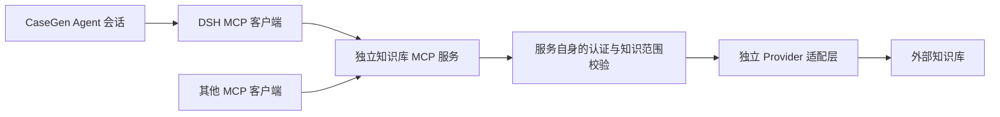

# 独立知识库 MCP 服务与 CaseGen 接入：方案与实施清单

- **日期**：2026-11-23
- **状态**：按独立服务方向更新，待实施；本文不代表 MCP 已开发、部署或通过联调。
- **CaseGen 接入分支**：`refactor/v2-clean-architecture`
- **目标**：建设可独立开发、安装和部署的知识库 MCP 服务，供 DSH 等 MCP 客户端按需搜索外部知识库、读取原文。CaseGen 作为使用方接入。
- **关联决策**：[重构决策记录](../specs/2026-11-20-casegen-refactor-decisions.md)、[重构实施计划](2026-11-20-casegen-refactor-plan.md)。本文细化 Agent 外部知识工具接入，并明确 MCP 与平台的依赖边界。

## 1. 已确认的前提与范围

1. 用户要求将 MCP 工具剥离平台。独立服务直接连接外部知识库，自行管理知识源配置、上游凭据和访问授权，具备独立的安装包、启动入口、测试与部署说明。
2. MCP 运行时不导入 CaseGen 的 `app.*`，不读取其 SQLite、数据目录或 `.env`，不调用其内部知识代理 API，也不依赖 CaseGen 登录或进程存活。
3. 用户已确认 DSH 支持 MCP；DSH 直接连接独立 MCP 服务，Agent 按需调用知识工具。
4. 同一 DSH 会话保留此前轮次的输入和工具结果。后续轮次继续使用已有资料，需要新信息、刷新资料或恢复压缩后的细节时再检索，不要求每轮重复注入全部历史。
5. 重构后外部知识库是唯一知识源。CaseGen 聊天附件和专家技能继续由原有机制处理，不搬到知识 MCP 服务中。
6. 首版提供搜索、正文读取两个只读工具。知识库写入、文档同步、管理 UI 和传统流水线迁移不纳入本次实施。
7. CaseGen 现有流水线知识源配置及业务数据继续保留。独立 MCP 的知识源配置单独维护；首版不自动复制平台数据库中的配置或凭据。
8. 保留现有用例 Markdown、结构化 JSON 和按消息入库契约。现有非功能／架构／瓶颈测试范围由 CaseGen 预设定义，通用 MCP 工具不包含该业务人设。

## 2. 服务与平台的职责边界

| 部分 | 负责的内容 |
|---|---|
| 独立 MCP 服务 | MCP 协议入口、知识源配置、上游认证、检索聚合、原文读取、内容预算、来源信息、访问授权和服务日志 |
| 外部知识库 | 知识内容、检索和文档 API，以及其自身的账户与资源权限 |
| DSH / 其他 MCP 客户端 | 连接服务、携带访问凭证、向 Agent 提供工具、将结果纳入会话上下文 |
| CaseGen | 将有权使用的知识范围关联到本项目的 Agent 会话；管理自身用户／项目／会话权限、预设、聊天附件和用例入库 |

独立 MCP 使用通用 `scope_key` 表示授权知识范围、`source_key` 表示知识源。服务自身的配置或可信授权信息将知识范围映射到外部库资源；不将 CaseGen 的 `project_id`、用户表和会话表作为服务必需的数据模型。

CaseGen 对接时维护“平台项目 → MCP 授权知识范围”的映射。其他客户端按自己的业务语义接入同一工具契约，不要求创建 CaseGen 项目或登录平台。

独立服务拥有自己的版本和发布流程。建议在独立项目／仓库中实施；项目名称、仓库与磁盘位置在 P1 记录。本次文档更新不创建或发布新仓库。

## 3. 当前代码可参考的能力与迁移限制

以下为对当前 CaseGen 工作区源码的核对。这些文件是迁移参考，不是独立服务的运行依赖。

| 当前位置 | 可参考能力 | 独立化时的处理 |
|---|---|---|
| [知识 Provider 契约](../../../backend/app/services/knowledge_providers/base.py) | 命中片段、来源、能力声明及错误类型 | 建立独立数据结构，移除对 `ProjectKnowledgeSource` 数据库实体的依赖 |
| [Django Provider](../../../backend/app/services/knowledge_providers/llm_wiki_django.py) | 外部登录、Cookie 续期、搜索、正文读取及 HTTP 容错 | 改为接收服务自身的知识源配置对象，迁移所需 HTTP 路由、缓存及熔断工具，清除 `app.*` 依赖 |
| [知识聚合服务](../../../backend/app/services/knowledge_providers/service.py) | 多知识源检索、加权排序、去重及错误聚合 | 基于独立配置和授权范围选源，不查询平台 SQLModel 表 |
| [Agent 轮次服务](../../../backend/app/services/agent_turn.py) | 已有只读适配类和默认未启用的上下文钩子 | 保留为平台侧历史接入参考，不将其作为 MCP 的执行入口 |
| [DSH 网关](../../../backend/app/services/agent_gateway.py) | 创建和复用 DSH 会话 | 在平台侧完成独立 MCP 的连接与授权范围关联 |
| [DSH 预设](../../../deploy/dsh-presets/casegen-testcase/cordis.patch.yml) | 测试设计规则及结构化输出 | 在平台侧更新知识工具指令 |
| [工具守卫](../../../deploy/dsh-presets/casegen-tool-restrict/casegen-tool-restrict.mjs) | 现有工具白名单 | 在平台侧精确放行两个知识工具 |

现有 Provider 不能原样搬出运行，因为仍引用平台数据库实体和辅助模块。迁移可参考已验证的协议和处理逻辑，独立服务的安装、导入和测试必须脱离 CaseGen checkout。

平台原有 Provider 暂时服务于传统流水线；独立 MCP 的配置和适配实现会形成两套维护入口。这是首版独立化的成本，后续可评估提取通用版本化 SDK，但不通过共享平台数据库或反向调用平台来消除这项成本。

## 4. 目标调用链与配置

推荐使用 Streamable HTTP。服务单独监听 MCP 入口，实际路径、地址、SDK 与协议版本在 P1 依据 DSH 兼容情况锁定。默认部署在客户端可达的本机或私有网络，运行和升级不随 CaseGen 后端启停。

独立服务的配置至少包括知识源标识、Provider 类型、上游地址、外部资源范围、凭据引用、启用状态、检索参数及超时。上游凭据从服务自己的环境或受保护配置读取；访问 MCP 的客户端凭证与上游知识库登录凭据分开管理。

CaseGen 只保存使用该 MCP 所需的连接配置、凭证引用和授权范围映射。传统流水线原有配置与此独立，不自动同步；需要保持两者一致时，部署文档明确各自的配置位置与维护责任。

## 5. 首版工具契约

以下为拟实现接口，不代表当前已可调用。最终字段、参数边界及实际工具注册名在 P1 固定。通用工具不接收 CaseGen 用户、项目或会话 ID。

### 5.1 `search_knowledge(query, top_k?)`

- `query`：Agent 根据任务和会话历史形成的非空检索词。
- `top_k`：可选的返回条数；服务配置默认值和最大值。
- 搜索范围：当前调用凭证允许的知识范围内，已启用且配置有效的知识源。
- 每条命中返回：`document_ref`（可读取时）、`source_key`、来源名称、标题、文档路径、章节位置、片段和 `can_read`。
- 返回聚合状态及部分知识源失败的脱敏警告；部分源失败时保留有效结果。

`document_ref` 是独立服务可解析的引用，关联授权知识范围、知识源与外部文档。正文读取时重新校验访问范围；无法映射为可读文档的命中返回 `can_read=false`，保留片段和来源。

### 5.2 `read_knowledge(document_ref, offset?, limit?)`

- `document_ref`：搜索返回的文档引用，不接受任意 URL 或本地路径。
- `offset/limit`：文本的字符偏移与字符数，具体默认值和上限在 P1 固定。
- 返回：正文片段、来源、实际范围、`next_offset` 和 `has_more`。
- 超出单次预算时提供继续读取位置；对不支持正文、文件不存在、源停用和引用无效分别返回明确结果。

当前参考实现的外部正文接口返回完整文本。MCP 分段返回控制的是模型上下文大小，不能假定上游具备原生分页。需要处理首次响应大小与后续读取重复下载；若使用短期缓存，按授权范围、知识源和文档隔离，设置容量、有效期及文档变化后的处理方式。

### 5.3 状态与输出边界

| 状态 | 工具结果语义 |
|---|---|
| 成功 | 片段或原文，以及来源和可引用位置 |
| `not_configured` | 当前授权知识范围内没有可用知识源 |
| `no_hits` | 成功检索，但无相关结果 |
| 部分源失败 | 有效结果及失败源警告 |
| `all_sources_failed` | 所有目标源均未成功，不能解释为无相关知识 |
| `unsupported` | 所请求能力不被目标 Provider 支持 |
| 无效参数或引用 | 可定位的工具参数错误 |
| 认证、授权、超时或连接失败 | 经脱敏的错误类别，不伪装成空结果 |

在服务中统一限定查询长度、结果条数、片段长度、正文输出和调用时间。仅返回工具需要的业务字段，不返回凭据、Cookie、认证头或上游内部原始响应。

## 6. 独立授权与 CaseGen 对接

### 6.1 服务侧

1. MCP 服务独立认证客户端，并根据服务自身的配置或已建立的授权关系解析 `scope_key`。凭证具体载体、签发／续期／撤销方式在 P1 固定。
2. 每次搜索和阅读均检查授权、知识源启用状态和文档归属；协议 session ID、模型提供的范围名称或文档引用本身不能代替授权。
3. 服务不查询 CaseGen 用户、项目或会话表，不实时回调平台判断权限。撤销和授权更新通过独立服务自身的机制完成。
4. 并发调用的身份与缓存互相隔离，不维护全局“当前项目／当前用户”变量。其他客户端可独立配置和使用服务。

### 6.2 平台侧

1. CaseGen 依照现有用户／项目／会话权限选择允许使用的 MCP 授权范围，再由 DSH 以该范围的连接身份调用。模型不能通过参数切换到未授权范围。
2. 多项目部署需要不同范围的连接配置或受限凭证。P1 核对 DSH 的实际会话配置接口，避免不同项目共用一个全知识库管理员连接。
3. 平台负责在用户失效、项目权限变化或会话关闭后停止相关使用；需要撤销会话级授权时，通过独立服务提供的受控机制执行。MCP 服务自身不理解 CaseGen 的生命周期事件。
4. 平台内管理员也不能访问他人私密对话的语义继续由 CaseGen 保证；独立 MCP 不建立对平台私密对话的访问入口。
5. CaseGen 保留自身浏览器 Cookie、Origin/CSRF 规则，接入独立服务不要求调整平台全局认证中间件。

独立服务可以接受标准化的受限授权信息，但信任配置和凭证验证由服务自己完成，不依赖平台在线查询。具体方式须验证权限更新、服务重启和并发会话下的行为后才能作为实施结论。

## 7. CaseGen 预设及每轮提示调整

- 将“在给定知识空间目录内使用 glob/grep/read 查阅”改为调用 `search_knowledge`，片段不足时用 `read_knowledge` 阅读原文。
- 在测试点或用例依据中标注知识源、文档及章节；资料内容作为参考，不作为新的系统指令。
- 按会话进展执行测试设计：测试点未确认时先拆解，确认后生成，后续按意见修订；已有资料可继续使用，需补充或刷新时再查。
- 分别说明无配置、无命中和查询失败；资料不足时向用户确认补充资料或仅基于已有需求继续，不编造业务规则。
- 保留 Markdown、结构化 JSON、按消息入库、专家技能和既有测试范围。
- 修订附件中的路径限制说明，明确本地附件、专家技能与外部知识工具各自的访问方式；历史附件可通过会话上下文继续引用。
- 每轮继续组装本轮输入、新附件和技能短提醒，知识资料通过工具返回，不重复注入全部历史。不同时启用现有每轮预检索钩子。
- 按 DSH 实际注册的完整工具名称精确放行搜索与正文读取，保留现有其他工具边界。

## 8. 实施任务与依赖

### P1：固定独立项目、接口和授权设计

- [ ] 记录独立项目／仓库位置、安装包与启动入口，明确服务配置、凭据和发布责任。
- [ ] 固定知识源配置对象、`scope_key/source_key`、两工具契约、文档引用、分页及错误语义。
- [ ] 验证 DSH 的实际 MCP 连接、会话授权范围传递、连接复用和已有会话更新方式，记录脱敏配置。
- [ ] 固定 SDK／协议版本、传输及服务地址、客户端认证、授权变更和撤销机制。
- [ ] 明确平台原有流水线知识配置与 MCP 配置的独立维护方式。

**完成条件**：能用不含 CaseGen 数据结构的配置描述一次搜索授权；能说明 CaseGen 和另一个独立客户端如何接入，两个授权范围不会串用。

### P2：实现独立服务与 Provider

- [ ] 建立独立依赖清单、配置加载、日志、测试及发布结构，提供自己的 MCP 启停入口。
- [ ] 以当前 Django Provider 为参考实现独立适配器，移除平台模型、数据库及辅助模块依赖；支持上游认证、有限重试和熔断。
- [ ] 实现按授权范围选源、搜索聚合、文档引用、正文分段、能力检查及输出脱敏。
- [ ] 实现客户端认证、授权范围校验和失效处理，保护请求、引用和缓存之间的隔离。

**完成条件**：在仅安装独立服务的环境中，使用模拟外部知识库和测试 MCP 客户端完成发现、搜索、正文读取与失败路径测试。

### P3：连接 DSH 与 CaseGen

- [ ] 先在 CaseGen 之外配置 DSH 连接独立 MCP，完成真实工具调用。
- [ ] 在平台侧实现项目到 MCP 知识范围的映射及受限连接配置，补齐已有会话、续期和授权变化处理。
- [ ] 按实际工具名称更新白名单，验证可见且可执行。
- [ ] 保留现有 Agent 流式输出、取消和失败语义；工具失败不自动重发整轮 `prompt-stream`。

**完成条件**：独立 DSH 客户端及平台会话均能搜索、阅读和补查，并发项目保持正确范围，已有对话历史保留。

### P4：更新预设及提示

- [ ] 按第 7 节更新仓库预设和附件说明。
- [ ] 更新实际 DSH 预设与 MCP 配置，记录新会话和已有会话的生效方式。
- [ ] 验证带附件会话使用外部知识工具，以及结构化用例入库。

**完成条件**：知识工具说明与实际连接一致，测试流程连贯，用例输出仍兼容。

### P5：独立测试与平台回归

- [ ] 独立服务使用自己的临时配置和模拟 HTTP 测试正常返回、参数边界、分页、部分源失败、无命中及认证／超时错误，单元测试不调用真实模型。
- [ ] 覆盖不同客户端与授权范围隔离、伪造引用、源停用、凭证失效、缓存和并发请求。
- [ ] 在没有 CaseGen 源码、数据库及环境变量的干净环境中安装并运行；检查安装依赖及导入不含平台模块。
- [ ] 停止 CaseGen 后，用独立客户端完成搜索和正文读取，证明服务不反向依赖平台接口。
- [ ] 平台接入测试使用 `tmp_app_data`，模拟 MCP／DSH；回归现有会话权限、Agent 流式输出、附件及按消息入库。
- [ ] 扩展现有工具守卫自测：允许两个知识工具，其他既有禁止项继续拒绝。

**完成条件**：独立服务测试和平台受影响测试分别通过；独立运行有验证记录。平台侧可复用后端 `pytest` 及 `node deploy/dsh-presets/casegen-tool-restrict/selftest.mjs`，最终具体命令在实施后记录。

### P6：独立部署与真实联调

- [ ] 提供服务自己的安装、知识源及凭据配置、客户端授权、启停、升级和故障定位文档。
- [ ] 在平台文档中仅记录 MCP 使用方配置、项目范围映射及 DSH 预设更新步骤。
- [ ] 用真实外部知识库分别完成独立客户端和 CaseGen 的端到端验收，记录版本、步骤与脱敏证据。
- [ ] 验证多轮引用、补查、长文继续阅读、并发范围隔离、授权撤销及平台重启／停止时的服务独立性。

**完成条件**：独立服务可单独交付，平台作为客户端接通；自动化测试、独立部署与真实联调结果分别记录。

**执行顺序**：P1 → P2 → P3 → P4 → P5 → P6。实现各阶段时同步补充测试，P5 汇总回归。

## 9. 预计改动与交付物

| 位置 | 预计职责 |
|---|---|
| 独立 MCP 项目（位置在 P1 固定） | 安装包、服务入口、独立配置对象、Provider、授权、工具、测试及部署材料 |
| CaseGen `backend/app/services/agent_gateway.py` 及按需涉及的会话服务／接口 | 外部 MCP 连接与项目授权范围关联、生命周期处理 |
| CaseGen `backend/app/services/agent_turn.py` | 附件提示调整；根据实际接入清理无调用方的旧知识适配入口 |
| CaseGen `backend/app/config.py`、`backend/.env.example`，必要时项目配置及迁移 | 使用方所需的服务地址、凭证引用、范围映射配置；变更量由 P1 决定 |
| `deploy/dsh-presets/casegen-testcase/cordis.patch.yml` | 知识工具指令、多轮流程和来源引用 |
| `deploy/dsh-presets/casegen-tool-restrict/` | 工具放行和守卫自测 |
| CaseGen `backend/tests/` | 使用方连接、项目隔离和业务回归 |
| CaseGen `README.md`、相关部署材料 | 作为 MCP 使用方的配置及验证步骤 |

MCP SDK、Provider 实现、知识源凭据与服务生命周期属于独立项目。CaseGen 后端不挂载 MCP 入口；服务端 SDK 不因本方案加入平台依赖。平台如需新增配置字段，沿用现有版本化迁移并覆盖老数据兼容。

## 10. 最终验收清单

- [ ] 独立服务有自己的安装包、配置、启动命令、测试和部署说明。
- [ ] 无 CaseGen checkout、SQLite、`.env` 或运行中平台接口时，独立客户端仍可搜索及读原文。
- [ ] MCP 服务直接连接外部知识库，调用链不经过 CaseGen 知识代理。
- [ ] DSH Agent 能发现并实际调用两个工具；其他 MCP 客户端可按同一通用契约接入。
- [ ] 授权范围由可信配置／凭证确定，通用工具无需平台用户、项目或会话 ID。
- [ ] 不同范围、客户端及并发项目不串用数据，停用和撤销及时生效。
- [ ] 能区分无配置、无命中、部分失败和全部失败，输出有界且保留来源。
- [ ] 多轮可以继续使用已有资料，也能补查和读取长文后续片段。
- [ ] CaseGen 附件、技能、Markdown、结构化 JSON、按消息入库和原有流水线配置兼容。
- [ ] 独立部署、自动化测试、DSH 和 CaseGen 真实联调分别有证据，服务可独立升级和启停。

## 11. 参考

- [MCP 服务端能力说明](https://modelcontextprotocol.io/docs/learn/server-concepts)：工具发现、调用与资源等概念。
- [MCP 官方 Python SDK](https://github.com/modelcontextprotocol/python-sdk)：服务端实现与传输支持；实施时以选定版本为准。
