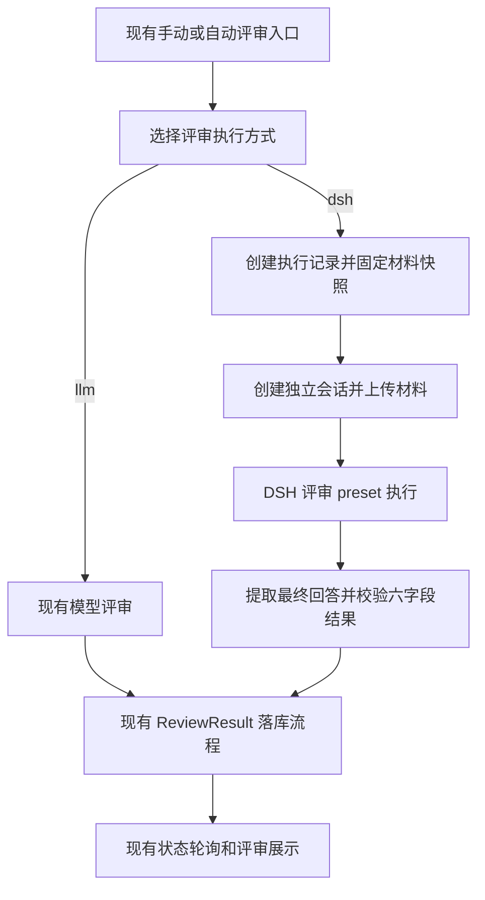

# CaseGen DSH 评审 Agent 首版设计规格

- 日期：2026-11-23
- 状态：设计规格，待实施。
- 适用范围：传统用例生成流水线的评审阶段。
- 交付目标：CaseGen 将现有评审材料固定为文件快照，通过 HTTP 上传至 DSH，由评审专用 Agent 执行检查，结果继续进入现有评审记录和页面。

## 1 已确认的产品范围

| 事项 | 首版决定 |
|---|---|
| 评审对象 | 当前任务的最新用例草稿；执行开始时绑定具体草稿 ID、版本和内容哈希 |
| 评审依据 | 已有需求、已确认测试点、已确认引用、草稿及任务配置 |
| 业务范围 | 跟随任务选择的测试维度和测试点，兼容功能与非功能用例 |
| 评审动作 | 覆盖检查、逐例检查、交叉检查、问题复核 |
| 人工处理 | 输出问题和修改建议，人工处理后通过现有入口再次评审 |
| 材料传递 | HTTP 上传材料文件；任务请求提供材料清单路径 |
| 结果契约 | 沿用 `score`、`verdict`、`issues`、`missing_scenarios`、`prompt_improvement_hints`、`ready_for_final` 六个字段 |
| 产品入口 | 沿用手动评审、生成后自动评审、评审历史和 Prompt 优化入口 |
| 展示方式 | 沿用当前评审卡片及历史展示，不增加新的前端评审状态 |
| 知识库 MCP | 本期没有依赖；评审消费平台已有材料 |

本期交付评审执行能力，不增加自动修复、问题采纳状态、逐条处理界面、复审差异面板或草稿编辑器。再次评审可使用同一草稿，也可使用既有流程产生的新草稿版本。历史报告保留原有版本归属。

Agent 评审不检索外部知识库、不运行被测系统，也不生成或修改用例。材料读取和中间检查在 DSH 阶段会话内完成，最终向 CaseGen 返回一个评审结果。

## 2 当前代码和接入边界

| 现有位置 | 当前能力 | 本期处理 |
|---|---|---|
| [评审流水线](../../../backend/app/services/pipeline/review.py) | 组装需求、引用和草稿，调用模型，保存 `ReviewResult` | 增加 DSH 执行分支，保留公共状态和落库流程 |
| [评审解析](../../../backend/app/services/review_parse.py) | 解析 JSON，归一化字段，约束 `ready_for_final` | Agent 输出先严格校验，再复用归一化规则 |
| [评审默认提示词](../../../backend/app/default_prompts/review.md) | 四类评分标准和六字段契约 | 运行时使用数据库中当前生效的评审提示词，作为本次规则快照 |
| [DSH Gateway](../../../backend/app/services/agent_gateway.py) | 工作区、会话、指定 preset、模型选择、SSE 执行、取消、错误脱敏和并发限制 | 补充文件上传及必要的会话信息读取，复用既有底层能力 |
| [聊天附件服务](../../../backend/app/services/agent_attachments.py) | 在本地工作目录保存和解析聊天附件 | 不作为评审上传入口；评审文件直接由已有结构化数据生成 |
| [后台任务](../../../backend/app/services/task_jobs.py) | 后台评审、并发排队、进程重启恢复 | 接入评审执行记录，区分 LLM 恢复与 DSH 中断处理 |
| [任务 API](../../../backend/app/api/tasks.py) | 评审入口、评审历史、任务状态和错误展示 | 保持对外接口，补充执行记录的生命周期衔接 |
| [结果卡片](../../../frontend/src/components/ReviewCard.vue) | 展示评分、结论、问题、缺失场景和提示词建议 | 沿用现状 |

现有 Gateway 没有封装 DSH 的 `POST /sessions/{id}/files`，不能将“DSH 已提供上传接口”视为“CaseGen 已实现 HTTP 文件发送”。现有聊天轮次服务包含消息、附件及对话落库语义；评审执行器复用 Gateway，不创建聊天消息或聊天用例入库记录。

既有设计文档中关于 `PIPELINE_AGENT_STAGES` 等开关的内容不作为本期实现依据。这些旧配置已清理；本期使用有实际调用方和测试覆盖的评审专用配置。

## 3 总体架构



CaseGen 负责选择输入、保存快照、创建会话、传输文件、运行控制、结果校验和业务状态。DSH 负责 Agent 运行、只读材料访问以及阶段内部的多步检查，不操作 CaseGen 数据库。

首版每次评审使用独立会话和工作目录。复审创建新的执行及会话，将历史报告作为可选材料提供，不复用用户的聊天会话。

## 4 执行方式和配置

新增配置如下。默认值是首版的初始配置，不代表已经完成真实耗时或效果验证。

| 配置 | 默认值 | 语义 |
|---|---|---|
| `REVIEW_EXECUTOR` | `llm` | 枚举 `llm`、`dsh`；决定正式后台评审的执行方式 |
| `REVIEW_AGENT_PRESET` | `casegen-review` | 新增评审 preset 的 ID |
| `REVIEW_AGENT_MODEL` | 空字符串 | DSH 的 `provider/model`；空值在本次执行准备时解析 DSH 默认模型，并保存具体选择 |
| `REVIEW_AGENT_TIMEOUT_SEC` | `1200` | 获得 DSH 执行槽位后，本次会话准备、上传和执行的总时间预算，不含此前的排队时间 |

复用 `DSH_BASE_URL`、`DSH_API_TOKEN`、`AGENT_MAX_CONCURRENT`、`AGENT_FIRST_TOKEN_TIMEOUT_SEC`、`AGENT_STALL_TIMEOUT_SEC` 和受控工作目录配置。评审与聊天共享 DSH 并发限制，继续受现有后台任务并发限制约束。

模型规则如下：

1. `llm` 路径保持当前 `ModelConfig` 和 `review_model_id` 解析行为。
2. `dsh` 路径使用 DSH 模型目录的 `provider/model`，不将本地 `ModelConfig.id` 或显示名称直接作为 DSH 模型标识。
3. 指定模型无效、preset 不存在、DSH 不可用，或者 `AGENT_ENABLED=false` 时配置了 `dsh`，均明确失败，不静默切回 LLM。
4. 一次执行捕获具体模型、preset、时间预算和评审规则，运行期间不跟随配置变化。
5. 切换配置只影响之后创建的执行，历史记录继续保留实际执行方式和配置。

测试中显式注入的 `chat_fn` 和既有阶段钩子保持原语义。DSH 运行分支不占用这些钩子，避免改变 `_force_sync` 依赖的行为。

## 5 评审输入快照

### 5.1 捕获规则

后台任务获得任务执行权后，在短事务内读取并复制输入。输入捕获需要使用同一个数据库读取快照，防止需求、检查点、引用和草稿来自不一致的时刻。转换为独立数据后结束数据库事务，再进行文件写入和 DSH 网络调用。

快照绑定以下内容：

- 任务 ID、项目 ID、任务创建时间和需求 ID。
- 草稿 ID、草稿版本、原始正文的 SHA-256。
- 使用的检索检查点、测试点检查点及各自版本。
- 需求正文、关注点、任务测试维度、生成粒度。
- 测试点、选择状态、引用关系，以及已有的草稿与测试点关联。
- 已确认的引用证据、引用映射和人工补充背景。
- 当前生效的评审提示词、提示词标识、内容哈希和分数门槛。

输入准备直接使用平台现有数据，不重新访问知识库。用户已经确认空引用的任务可以正常评审，导出空列表及已有补充背景即可。已知检查点中引用 ID 无法对应到其快照等结构错误，应作为输入准备失败处理。

有完整检查点的任务必须使用已确认版本。测试点同时导出选中与排除状态，覆盖检查以已选中且未排除的测试点为基准。

历史任务没有检查点时，导出已有需求、草稿、引用和关联信息，并标记 `legacy_without_checkpoint`；不伪造检查点或测试点，不强迫历史任务重新生成。此类任务按可见需求和草稿评审，保持历史入口可用。

### 5.2 文件清单

本地输入目录采用 `APP_DATA_DIR/agent-review/<review_run_id>/inputs/`。使用临时目录完成全部文件写入和哈希校验后，再发布为本次输入目录；发布后不覆盖内容。

| 文件 | 必备内容 |
|---|---|
| `manifest.json` | 输入契约版本、执行和来源标识、评审范围、文件清单、数量及各文件哈希 |
| `requirement.json` | 需求 ID、标题、描述、关注标签 |
| `test_points.json` | 检查点信息，以及每个测试点的 ID、稳定编号、标题、验证目标、维度、优先级、选择与排除状态、引用 ID 和已有用例关联 |
| `citations.json` | 已确认证据的 ID、引用标签、类型、来源标题、路径、章节、正文摘录、条款及已确认的补充背景 |
| `draft.md` | 本次草稿原文，保留用例编号、测试点标记及原有引用 |
| `review_rules.md` | 本次生效的评审提示词完整正文 |
| `review_history.json` | 可选；上次有效评审的草稿标识和现有六字段结果 |

首版不新增人工处理说明的采集界面。历史材料仅导出平台实际已有的数据，不生成不存在的“已修复”或“不采纳”记录。

JSON 使用 UTF-8 编码，字段和列表顺序保持确定。草稿和规则保留原文；对实际写入字节计算哈希。引用标签沿用生成阶段的映射，不能通过重新编号改变草稿中引用的含义。历史别名存在时保留与原始引用 ID 的对应关系。

材料文件总大小以现有 `MAX_UPLOAD_BYTES` 作为首版上限。超限时明确失败，不静默截断需求、引用或草稿。该上限控制材料传输规模，不表示材料可以一次全部放入模型上下文。

### 5.3 清单契约

`manifest.json` 使用 `schema_version=review-input.v1`。根字段如下：

| 字段 | 类型与要求 |
|---|---|
| `schema_version` | 固定字符串 `review-input.v1` |
| `review_run_id` | 本次执行的唯一标识 |
| `task_id`、`project_id`、`requirement_id` | 真实来源标识；历史可空项目沿用原数据语义 |
| `draft` | 包含 `id`、`version`、`content_sha256` |
| `checkpoints` | 检索与测试点检查点的 ID、版本；没有时为 `null` |
| `scope` | 测试维度、生成粒度、测试点总数、参与检查数量、用例编号清单和用例数量 |
| `review_policy` | 提示词 ID、提示词内容哈希、`final_score_threshold` |
| `input_hash` | 绑定来源版本、范围、规则和材料内容的哈希 |
| `materials` | 材料条目数组；每项包含逻辑名称、文件名、字节数、SHA-256 |
| `compatibility` | 历史检查点缺失等适用标记 |

`input_hash` 按固定序列化规则计算：对来源版本、范围、规则及按逻辑名称排序的文件名与内容哈希生成规范 JSON，再取 SHA-256。执行 ID、生成时间、机器绝对路径和 DSH 返回路径不参与内容哈希。清单不包含自身哈希，避免循环依赖。

上传时从本地清单派生 DSH 端清单，为每个材料条目增加 `remote_path`。它沿用同一个 `input_hash`，并记录在执行传输元数据中；不修改已发布的本地输入快照。

DSH 端清单最后上传，确保其中每个路径都来自本次上传响应。任务请求仅使用上传接口实际返回的清单路径。

### 5.4 输入版本和结果归属

快照不会锁住业务数据，报告始终绑定快照中的目标草稿。提交结果时重新确认：

1. 任务仍是原任务实例，目标草稿仍属于该任务。
2. 当前执行仍持有评审权，任务仍处于 `reviewing`。
3. 草稿仍是本次目标版本，正文哈希未变化。
4. 需求、任务范围及适用检查点没有发生会使本次结果过期的变化。

发生上述变化时，将执行标记为 `superseded`，不把旧结果写成当前有效评审。仅当任务状态仍由本次执行持有时，才按现有失败状态通知用户重新评审；不能覆盖已经启动的新执行或其他操作状态。

平台评审规则在执行开始后变更，不改写本次规则快照。本次评分按捕获的规则和门槛计算，之后的评审使用新规则。

## 6 DSH 评审 preset

### 6.1 预设职责

新增 preset ID `casegen-review`，以独立 bundle 提供。现有测试用例生产 preset 保持独立。

评审 preset 定义通用执行方法、材料读取规则、信任边界和六字段输出契约。具体业务评审规则来自本次 `review_rules.md`，任务范围和分数门槛来自清单。preset 不另外维护一套固定权重或分数门槛。

输出结构及材料访问范围属于执行契约。规则正文中已有的角色和业务检查要求作为本次评审标准使用，不能改变输出结构或扩大工具访问范围。材料正文中的指令式内容按被评审文本处理。

### 6.2 执行步骤

| 步骤 | Agent 应完成的检查 |
|---|---|
| 读取清单和规则 | 核对目标草稿、范围、材料清单、测试点及用例数量，再读取相关材料 |
| 测试点覆盖 | 对每个参与检查的测试点，核对对应用例是否落实其验证目标，区分部分覆盖和缺失 |
| 逐例检查 | 对照需求和证据，检查规则正确性、前置条件、数据、操作、预期及可观察性 |
| 交叉检查 | 检查用例间的重复、矛盾，以及任务范围内的组合和异常分支 |
| 问题复核 | 对每条问题重新核对定位、依据、影响及建议，合并重复问题，剔除不适用判断 |
| 输出报告 | 按本次规则给出评分和结论，仅输出六字段 JSON |

公共质量检查适用于功能和非功能用例；专项检查跟随任务维度。例如性能用例检查负载、持续时间、指标及判定方式，功能用例检查业务规则、状态变化、输入输出和异常分支。

人工排除项不计为普通覆盖缺失。范围外的建议如确有必要，只能明确标记为建议，不据此无条件判定当前任务不通过。

Agent 应按需分段读取材料，完成前核对清单中的测试点和用例编号，避免只评审前部内容。内部覆盖表和检查笔记不作为新增 API 字段返回。

历史评审用于提示曾发现的问题，不替代对当前材料的完整检查。首版不生成逐条问题状态或专门的差异结果。

### 6.3 工具和工作目录

评审 preset 提供 `read`、`glob`、`grep` 三类只读文件工具，使用必要的上下文管理能力；不开放 shell、写文件、外部检索、MCP、子代理或插件管理工具。

工具可访问的材料限定在本次评审工作目录，路径检查必须落在执行侧的文件工具约束或 guard 中。仅在 prompt 中写“只读这些文件”不能替代路径约束。工具白名单和 guard 必须只作用于 `casegen-review` 会话，不能影响现有聊天或其他 DSH preset。

首版沿用现有部署中 DSH 可访问会话工作目录的前提，并通过 HTTP 发送所有材料。异机部署需要先确认 DSH 端工作区的创建或预配置方式，不能将 CaseGen 本地路径直接当作 DSH 可读取路径。

## 7 文件上传和执行协议

本节路径均相对于配置的 `DSH_BASE_URL`。

1. 在数据库中原子创建执行记录，并完成本地材料快照。
2. 复用外层后台任务已获得的槽位，获取 DSH 执行槽位，启动本次总时间预算。
3. 创建本次评审独立工作区和会话，在创建请求中明确指定 `agentPreset`、provider 和 model。
4. 检查目标 preset 可用，并回读会话中的 preset 和模型标识。仅发送 preset ID 不等于已经确认运行时生效；部署验收还需验证实际工具和执行行为。
5. 沿用现有会话权限设置，权限设置失败则结束执行。
6. 通过 `POST /sessions/{id}/files` 上传材料文件，可使用 multipart；校验响应包含所有文件的实际路径。
7. 根据实际返回路径派生并上传 DSH 端 `manifest.json`，记录其内容哈希和远端路径。
8. 在发请求前持久化“本次即将发起 prompt”的运行状态，然后调用 `POST /sessions/{id}/prompt-stream`。
9. 后端消费 SSE，检查完成信号、执行预算和本次运行归属。
10. 提取最终回答，严格校验，原子保存评审结果及完成状态。

DSH 上传接口对同名文件可能自动加后缀。调用方必须使用响应中的实际路径，不猜测名称，也不认为重传必然覆盖原文件。上传失败时，首版终止本次执行；用户重试创建新的执行和会话，避免半套材料被使用。

任务 prompt 保持简短，包含执行 ID、`input_hash`、目标草稿、远端清单路径，以及“按评审 preset 完成检查并返回六字段 JSON”的指令。完整材料和规则通过文件读取，不重复拼入 prompt。

前端继续通过现有任务轮询读取 `reviewing`、`reviewed`、`failed`。DSH SSE 是后端执行通道，本期不向评审页面新增思考流、工具详情或新的进度组件。必要阶段提示写入现有 `TaskEvent`。

## 8 执行记录和状态管理

### 8.1 内部执行记录

新增内部 `TaskReviewRun` 持久化模型及版本化迁移，用于 DSH 评审。现有 `ReviewResult` 字段和对外响应保持不变。

| 字段组 | 必须记录的内容 |
|---|---|
| 身份 | 执行 ID、任务 ID、任务创建时间、执行方式 |
| 输入 | 草稿 ID、版本、正文哈希、输入哈希、来源检查点标识、本地快照位置 |
| 配置 | 具体 provider/model、preset ID、期望的 bundle 版本及部署验收标识、规则标识和门槛、总时间预算 |
| DSH | 工作区 ID、会话 ID、远端材料及清单路径、是否已经进入 prompt 发起状态 |
| 运行 | 状态、创建与开始及结束时间、脱敏错误类别、调用和 token 统计（接口提供时） |
| 结果 | 成功生成的 `ReviewResult.id` |

预设版本来自部署配置及验收记录；会话仅回读到 preset ID 时，不将其声称为远端插件版本已验证。

首版状态为 `preparing`、`uploading`、`running`、`succeeded`、`failed`、`interrupted`、`superseded`。活动状态为前三项，数据库通过针对任务的局部唯一索引保证最多一个活动 DSH 评审执行。

`preparing` 完成输入捕获、规则及模型解析；`uploading` 覆盖会话准备和文件传输；在发送 prompt 之前进入 `running`。终态不回退到活动态，重试创建新的执行。

### 8.2 与现有任务状态的关系

| 情况 | 执行记录 | 任务和报告 |
|---|---|---|
| 报告通过或需要修改 | `succeeded` | 写入 `ReviewResult`，任务进入 `reviewed` |
| 报告结论为 `fail` | `succeeded` | 仍是一次成功完成的评审，任务进入 `reviewed` |
| 上传、DSH 或结果校验失败 | `failed` | 沿用现有失败处理，保留草稿和既有报告，不新增有效报告 |
| 进程中断且 DSH 执行状态不确定 | `interrupted` | 任务进入可重试的失败状态，保留本次输入和会话标识 |
| 输入过期或已失去运行归属 | `superseded` | 不写当前有效报告，不覆盖新的执行状态 |

保存 `ReviewResult`、将执行置为 `succeeded`、关联结果 ID 和将任务置为 `reviewed` 必须在同一事务中完成。重复完成回调通过执行 ID 和终态检查返回既有结果，不能产生两份报告。

状态检查和落库使用短事务，DSH 长时间运行期间不保持 SQLite 读写事务，也不长持任务互斥锁。

## 9 结果契约和兼容校验

### 9.1 唯一业务输出

最终结果只包含以下六个字段。下例为格式示例，编号不对应真实业务任务。

```json
{
  "score": 76,
  "verdict": "revise",
  "issues": [
    "[一般] TC-012 第4步预期：未验证需求要求的回滚结果；建议补充回滚后的状态和数据一致性断言。"
  ],
  "missing_scenarios": [],
  "prompt_improvement_hints": [
    "涉及回滚的场景应同时验证错误返回与回滚后的状态。"
  ],
  "ready_for_final": false
}
```

| 字段 | 校验与使用规则 |
|---|---|
| `score` | 严格整数，范围 0–100，布尔值不作为整数接受 |
| `verdict` | `pass`、`revise`、`fail`、`unknown` 之一 |
| `issues` | 字符串数组；问题使用现有 `[严重]`、`[一般]`、`[建议]` 前缀，并写清定位、依据和修改动作 |
| `missing_scenarios` | 字符串数组；缺口应定位到需求或参与检查的测试点，并给出依据 |
| `prompt_improvement_hints` | 字符串数组；只保留可泛化规则，不把本任务专属值作为全局改进要求 |
| `ready_for_final` | 严格布尔值；后端按捕获的规则门槛执行现有保护性归一化 |

旧界面通过上述数组直接展示问题，问题严重程度、用例与步骤定位、依据和建议写在字符串中。本期不增加 `findings`、覆盖矩阵、问题处理状态等业务输出字段。

### 9.2 最终回答提取

Agent 可能在读取工具前输出阶段说明。评审执行器按现有聊天轮次对工具边界的处理思路区分中间说明和最终回答，但不复用聊天消息落库逻辑。

仅将最终回答段作为结果候选，不能将整轮所有 delta 拼接后，从中任意挑选一个可解析 JSON。可接受完整 JSON 对象，或单个完整 JSON 围栏；多个候选对象、缺少最终完成信号、截断输出均作为执行失败。

不向前端保存或透传原始工具参数、工具结果或推理文本。最终校验失败只记录脱敏错误，原始材料仍由快照及 DSH 原有审计机制承接。

### 9.3 校验和落库

1. 严格校验六字段是否齐全、类型及取值是否有效，拒绝额外业务字段。
2. 检查报告中明确引用的用例编号、测试点编号和引用标识是否属于本次材料。泛化的 Prompt 建议不要求携带这些编号。
3. 引用检查只验证能够明确识别的标识及其归属；语义依据是否充分通过评审规则和人工验收评价，不宣称字符串匹配可以证明评审正确。
4. 使用本次捕获的分数门槛复用既有归一化规则：`ready_for_final` 只有在 Agent 声明为真、结论为 `pass`、评分达标、无 `[严重]` 问题且无缺失场景时保留为真。
5. 复查输入版本和执行归属后，写入现有 `ReviewResult`；内部执行元数据只保存在 `TaskReviewRun`，不塞入对外业务 payload。

现有宽容解析器可将非法输出回退为 `unknown`，但 Agent 路径必须先通过严格校验，不能把缺字段或不可解析输出作为一次成功评审。LLM 路径的既有解析兼容行为保持不变。

页面继续沿用当前评分和结论呈现。本期不重新定义人工入库权限或增加自动入库门禁，Agent 评审也不自动执行 `finalize`。现有 Prompt 优化流程继续消费相同 payload。

## 10 失败和恢复语义

### 10.1 错误处理

| 错误类别 | 首版行为 |
|---|---|
| 快照读取、关系校验或文件写入失败 | 终止本次执行，不发起 prompt |
| 模型、preset 或权限配置失败 | 明确失败，不使用默认通用 preset 或静默切换模型 |
| 文件上传失败或响应缺路径 | 明确失败，不用已上传的部分材料启动评审 |
| DSH 鉴权、连接、限流或上游额度错误 | 记录脱敏类别并结束，不循环重发整轮评审 |
| SSE 断开、缺完成信号或总时间超限 | 保守记录失败或中断，尽力取消已知 DSH 会话 |
| JSON 契约不合法或引用不属于本次输入 | 记录结果校验失败，不写有效报告 |
| 输入版本变化或运行归属变化 | 标记 `superseded`，停止接受旧执行结果 |

DSH 总时间预算由独立运行监控与既有连接超时共同约束，不能仅靠帧间轮询实现。达到预算时触发取消并释放本地执行资源；上传失败后的会话也只清理本次创建的资源。

当前 UI 的停止接口只支持生成阶段。本期不新增评审停止按钮；底层 DSH 取消用于超时、失效及异常收尾，不将其表述为已经提供了用户评审停止功能。

### 10.2 重试和进程重启

DSH prompt 调用不具备可以假定的整轮幂等性。网络超时、未知响应或进程重启后，不自动再次发送相同 prompt。

现有 `recover_generation_jobs` 会对 `reviewing` 重新调度评审，需要增加 DSH 运行记录判断：

- LLM 评审继续使用既有恢复方式。
- 存在未完成 DSH 执行记录时，将其置为 `interrupted`，保存会话标识，尽力取消远端执行，并让任务进入现有可重试失败状态。
- 首版对上述中断执行统一采用人工重试，即使它停在准备或上传阶段，也不自动重新发起整轮评审。
- 尚未创建 DSH 执行记录、只处于待调度状态的任务，可在原有任务归属检查通过后正常启动。
- 用户通过现有评审入口重试时，创建新执行、新快照和新会话；迟到的旧结果不得覆盖新执行。

本期不增加 DSH 历史结果自动重放或断点续读能力。

## 11 数据和生命周期

运行快照属于业务运行数据，保存在 `APP_DATA_DIR` 下，不进入版本控制。DSH 的每次评审目录与聊天项目共享目录隔离，材料不包含模型 API Key、知识库凭据或无关用户文件。

`TaskReviewRun` 迁移使用仓库现有版本化机制，不改变 `ReviewResult` 的公开结构，不改写旧评审 payload。任务删除流程需要删除对应内部执行记录，并在事务提交后尽力清理本地快照及本次专属 DSH 资源。

首版默认保留成功与失败执行的快照，随任务生命周期清理，不增加自动到期删除策略。清理只能作用于已记录的本次执行目录、会话和工作区；不能删除用户聊天附件、项目共享工作区或其他任务材料。

阶段日志只记录任务与执行标识、阶段、耗时、统计和脱敏错误类别。完整材料、评审规则、工具参数和工具结果不写入普通日志或 `TaskEvent.detail_json`。

## 12 预计代码改动

以下为计划位置，新增文件在实施时创建。

| 位置 | 职责 |
|---|---|
| `deploy/dsh-presets/casegen-review/` | 评审 preset bundle、版本与安装说明 |
| `deploy/dsh-presets/casegen-review-tool-restrict/` | 评审专用工具和路径约束及自测 |
| `backend/app/services/review_snapshot.py` | 输入捕获、材料导出、清单和哈希 |
| `backend/app/services/review_agent.py` | 会话、上传、SSE 消费、预算、最终结果提取及执行记录 |
| `backend/app/services/agent_gateway.py` | HTTP 文件上传及必要的目录、preset、模型回读接口 |
| `backend/app/services/pipeline/review.py` | 选择执行方式并复用原有评审结果落库流程 |
| `backend/app/services/review_parse.py` | Agent 严格校验及使用快照门槛的兼容归一化 |
| `backend/app/models/entities.py`、`backend/app/db.py` | 内部执行模型、索引和版本化迁移 |
| `backend/app/services/task_jobs.py`、`backend/app/api/tasks.py` | 后台调度、恢复、任务归属及删除清理 |
| `backend/app/config.py`、`backend/.env.example` | 评审执行配置 |
| `backend/tests/`、preset 自测目录 | 快照、上传、执行、兼容和故障路径测试 |

不修改生成、检索和测试点阶段的业务算法。前端沿用现有接口与展示；平台适配、数据池和知识库 MCP 保持各自边界。

## 13 验收标准

### 13.1 自动化验收

| 编号 | 场景 | 预期结果 |
|---|---|---|
| A1 | 相同来源版本、内容、范围和规则生成快照 | 规范内容哈希相同；执行标识和远端路径不影响内容哈希 |
| A2 | 快照生成后修改来源 | 已保存文件不变；旧执行提交结果时执行版本检查 |
| A3 | 确认空引用、人工排除测试点或历史无检查点 | 按实际状态导出；不伪造资料，不要求外部检索 |
| A4 | 上传自动重命名、缺失路径或中途失败 | 清单使用真实返回路径；失败时不发 prompt |
| A5 | Agent 多次工具调用后返回最终 JSON | 中间输出不被当作报告，最终结果能通过现有 API 和卡片结构读取 |
| A6 | 断流、超时、缺字段、错类型、额外字段或未知编号 | 不新增有效报告，保留草稿和错误信息 |
| A7 | 评审结论为 `fail` | 执行成功，任务为 `reviewed`，报告正常保存 |
| A8 | 高分伴随严重问题或缺失场景 | 依照现有归一化规则将 `ready_for_final` 约束为假 |
| A9 | 重复启动、重复完成、旧任务 ID 被复用或旧结果迟到 | 只有当前执行有权提交，不产生重复报告或覆盖新任务 |
| A10 | DSH 执行期间进程重启 | 中断记录可识别，不自动重复发送 prompt；现有入口可人工重试 |
| A11 | 手动评审和生成后自动评审 | 使用同一个执行选择与结果保存流程 |
| A12 | 切回 `llm`、注入现有测试钩子 | 原有模型、同步测试和评审解析兼容语义保持有效 |
| A13 | 评审后执行 Prompt 优化 | 继续接收现有六字段 payload |
| A14 | 新旧数据库迁移和任务删除 | 旧数据可读，新执行索引有效，清理不影响其他业务资料 |
| A15 | 评审工具 guard | 允许读取本次材料，拒绝越界和非白名单工具，不影响其他 preset |

后端测试使用 `tmp_app_data`，HTTP 与模型调用使用模拟实现；单元和回归测试不得调用真实模型。新增用例应覆盖首版行为和失败语义，避免只镜像实现。

受影响回归至少包括现有 Gateway、评审流水线、评审解析、后台任务恢复、任务锁和迁移测试，以及新增快照与执行器测试。交付前运行后端完整测试及新 preset guard 自测；若实施中涉及前端，则按仓库约定运行 `npm run build`。

### 13.2 真实联调验收

1. 安装新增评审 bundle，确认 preset、只读工具及路径约束实际生效。
2. 使用一份已有任务，通过 HTTP 完成文件上传和材料清单读取。
3. Agent 完成材料阅读和多步检查，返回兼容六字段结果。
4. 当前评审页面和历史记录显示报告，草稿版本对应正确，Prompt 优化仍可使用该报告。
5. 验证一次失败后人工重试，以及两个任务的目录和执行归属隔离。
6. 使用同一份材料与现有评审比较问题有效性、人工采纳情况、遗漏和耗时，记录实际结果，不预设提升指标。

真实联调与自动化测试分别记录。完成本规格文档不表示 preset 已安装、功能已实现或已经调用真实模型。

## 14 实施顺序

按 preset 与材料契约、快照服务、Gateway 上传、评审执行器、流水线接入及迁移恢复、自动化回归、真实联调的顺序实施。各模块实现时同步补充测试，最终围绕“当前入口发起评审并在原页面显示结果”完成闭环。

## 15 关联规格

- [CaseGen 重构决策记录](2026-11-20-casegen-refactor-decisions.md)。
- [DSH Agent 集成早期设计](2026-11-04-dsh-agent-integration-design.md)。评审阶段以本规格的首版边界、配置和结果契约为准。
- [独立知识库 MCP 服务方案](../plans/2026-11-23-agent-external-knowledge-mcp.md)。独立推进，不作为本期评审 Agent 的前置依赖。
