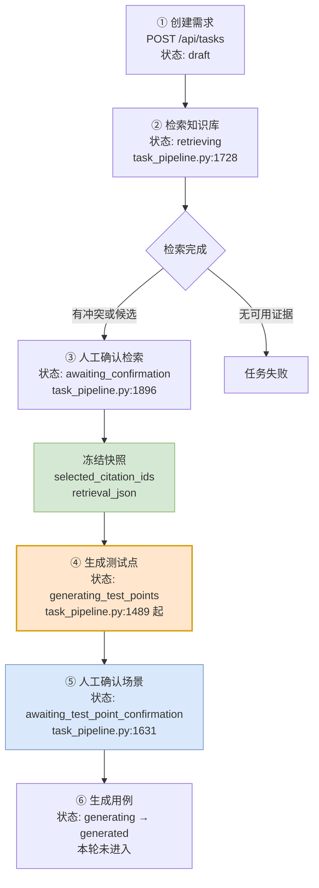
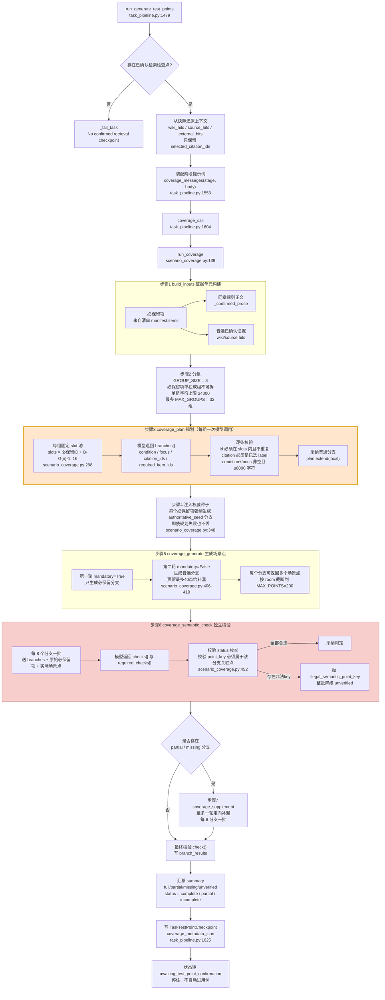
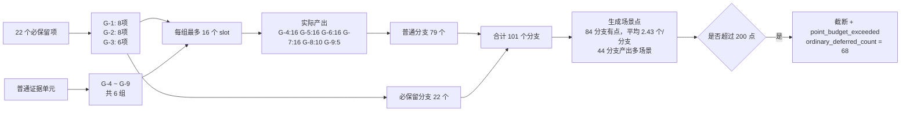
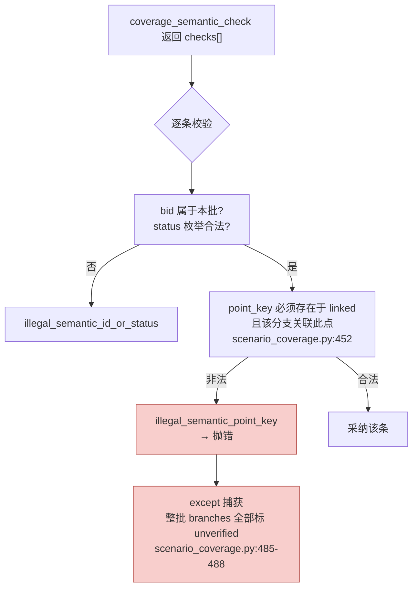

# CaseGen 场景生成流程详解（含规划环节）

记录日期：2026-10-20。本文按 `backend/app/services/task_pipeline.py` 与 `backend/app/services/scenario_coverage.py` 的实际代码整理，行号对应当前工作区版本。

## 一、整体六阶段

**关键边界**：第 ③ 步确认后快照冻结。第 ④ 步及之后**只读快照**，不再检索知识库、不读原始文件。这是硬约束，代码上由 `run_generate_test_points` 只接受 `status == "confirmed"` 的检索检查点保证。

## 二、第④阶段内部展开（规划在这里）

## 三、101 个分支是怎么算出来的

以本次集合竞价任务20为例：

### 为什么集合竞价特别容易顶满

| 环节 | 集合竞价 | 单笔成交金额 | 差异原因 |
|---|---:|---:|---|
| 必保留项 | 22 | 14 | 规则条款多 |
| 规划组数 | 9 | 较少 | 证据单元多 |
| 普通分支 | 79 | 少 | 4 组顶满 16 slot |
| 生成点 | 200（上限） | 23 | 单分支多场景叠加 |
| 内部状态 | partial | complete | 预算耗尽 |

三层放大：**证据单元多 → 组多 → 每组 16 slot → 单分支多场景**。200 点上限在证据密集章节必然不够。

## 四、8 条非法 key 的位置

当前行为是**单条非法 → 整批作废**。修复方案（用户已确认方案2）：单条降级 unverified，其余合法分支照常采纳，不整批作废。

## 五、预算与上限常量

| 常量 | 值 | 位置 | 作用 |
|---|---:|---|---|
| `MAX_POINTS` | 200 | scenario_coverage.py:16 | 单任务场景点总数上限 |
| `MAX_CALLS` | 192 | :17 | 模型逻辑调用总次数 |
| `MAX_GROUPS` | 32 | :18 | 规划分组数上限 |
| `GROUP_SIZE` | 8 | :19 | 每批证据单元数 |
| `MAX_GROUP_CHARS` | 24000 | :20 | 单组序列化字符上限 |
| `MAX_INPUT_CHARS` | 4000000 | :21 | 累计输入字符上限 |
| `MAX_CALL_CHARS` | 64000 | :22 | 单次请求字符上限 |
| 每组 slot 数 | 16 | :298 硬编码 `range(1,17)` | 每组普通分支产出上限 |
| 补漏预留 | 最多 40 点 | :410 | 普通轮次预留点数 |

## 六、几个容易误解的点

1. **规划不是独立阶段**，是 `generating_test_points` 内部第一步，UI 上只显示“正在生成测试点”。
2. **规划与生成是两次不同模型调用**：`coverage_plan` 产出分支条件，`coverage_generate` 才产出场景标题与验证目标。
3. **规划看不到全文**，只看该组证据单元和同章规则正文片段。
4. **必保留项不依赖规划成功**：代码用 `authoritative_seed` 强制注入，规划失败也不会丢原始清单。
5. **核验是独立的第三方判断**，不复用规划摘要，逐条对照原文条件。
6. **补漏只针对 partial/missing**，unverified 不触发补漏，这是 8 条 unverified 没被自动修复的直接原因（`scenario_coverage.py:494`）。
